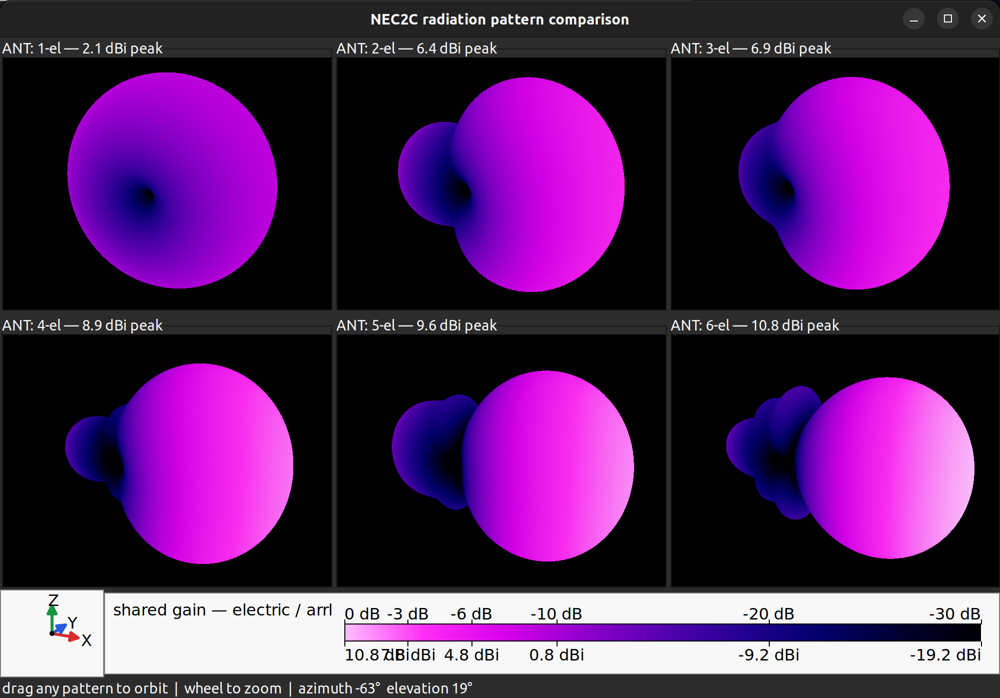

# Antenna Turtle

Antenna Turtle is a Racket DSL for constructing antenna wire geometry with a
stateful 3D turtle. It exports NEC/`nec2c`, MMANA-GAL Basic, and approximate
MATLAB Antenna Toolbox geometry, and can display the generated geometry in an
interactive Plot3D preview.

In addition to geometry export, Antenna Turtle can drive `nec2c` directly and
return feedpoint, VSWR-sweep, radiation-cut, and spherical-pattern data to the
program. Named feeds support independent voltage amplitude and phase. NEC2C
models may use free space, perfect ground, or configurable real ground;
MATLAB exports include a directly runnable far-field directivity stub.

The experimental OpenEMS branch also supports ordinary Turtle wires converted
to physical Manifold capsule unions, Manifold PEC, lossy dielectric, and
rectilinear finite-conductivity volume bodies, planar PEC/conducting sheets,
one- and multiport lumped feeds,
ideal lumped R/L/C regions, Octave/OpenEMS S-parameter sweeps, a solid-model
preflight viewer, and the same
return-loss, impedance, and Smith-chart windows used for NEC2C data. Broadband
NF2FF recording also feeds the existing 3-D radiation-pattern viewers at the
model, best-match, or another swept frequency. A model-frequency power-budget
report combines direct port power, radiation, dielectric heat, lumped-resistor
heat, and the remaining conductor/numerical loss. See
[the staged OpenEMS design](docs/OPENEMS-SOLID-DESIGN.md) and
the volume-body [`examples/openems-dipole.rkt`](examples/openems-dipole.rkt)
and dielectric/sheet [`examples/openems-patch.rkt`](examples/openems-patch.rkt)
references. [`examples/openems-wire-yagi.rkt`](examples/openems-wire-yagi.rkt)
builds one ordinary wire Yagi and compares its NEC2C and OpenEMS patterns.
[`examples/openems-patch-dsl.rkt`](examples/openems-patch-dsl.rkt) shows the
turtle-oriented solid layer, scoped units/materials, simulation profiles, and
data-only `simulate`/`radiation-pattern` workflow.
For multiport work, [`examples/openems-two-port-microstrip.rkt`](examples/openems-two-port-microstrip.rkt)
is a compact diagnostic and
[`examples/openems-interdigital-bandpass.rkt`](examples/openems-interdigital-bandpass.rkt)
models a three-resonator distributed filter.
[`examples/openems-lumped-load.rkt`](examples/openems-lumped-load.rkt) and
[`examples/openems-lumped-bandpass.rkt`](examples/openems-lumped-bandpass.rkt)
exercise one-port and two-port hybrid lumped/distributed networks.



Documentation:

- [User Manual](docs/USER-MANUAL.md), including Windows 11 installation
- [Native macOS installation](docs/MACOS-INSTALL.md), including the Homebrew bootstrap script
- [API Guide](docs/API.md)
- [Emacs support](editors/antenna-turtle-emacs.el) for indentation and font lock

## Install

On macOS, a full checkout can install the complete native solver and solid
modeling stack with:

```sh
./scripts/install-macos.sh
```

See the [macOS installation guide](docs/MACOS-INSTALL.md) for the local
dependency layout, environment activation, and unattended options.

For an existing cross-platform dependency installation, install the Racket
package directly from this directory:

```sh
raco pkg install --auto --link "$PWD"
```

The base installation does not require Manifold. It supports wire models and
the NEC2C, MMANA, and MATLAB file exporters. When the `racket-manifold`
package and its native library load successfully, the same `#lang
antenna-turtle` language also exports the solid-modeling and OpenEMS API. To
enable that optional backend after installing Antenna Turtle:

```sh
raco pkg install --auto --name racket-manifold https://github.com/N5HXR/racket-manifold.git
raco setup antenna-turtle
```

Without Manifold, loading an Antenna Turtle model prints a short capability
warning. Wire-only programs continue normally; solid-modeling names are not
bound and therefore produce Racket's ordinary unbound-identifier error if
used. After repairing or installing Manifold, rerun the `raco setup` command
above so the language is recompiled with the full export set.

Run a model with ordinary Racket to construct and validate its geometry without
creating output files:

```sh
racket examples/dipole.rkt
```

Add `(show-model)` after the geometry to open a rotatable preview, or request
one while building:

```sh
raco antenna-turtle build examples/dipole.rkt --view
```

Build the standard NEC2C, MMANA, and loft-MATLAB outputs with:

```sh
raco antenna-turtle build examples/dipole.rkt
```

MMANA output supports a save-and-regenerate workflow. The first build creates
the usual default `.maa` file. After you configure and save that file in
MMANA-GAL, later builds replace the title, frequency, wires, sources, and loads
while preserving the saved segmentation and calculation settings. Frequency
remains controlled by `model-frequency`; loads are cleared during regeneration.

To remove the linked package later:

```sh
raco pkg remove antenna-turtle
```

## Minimal model

```racket
#lang antenna-turtle

;; Defaults: 14.1 MHz, wavelength/20 segmentation, wavelength/1e6 vertex
;; snapping, 1 mm wire, 50-ohm reference impedance, and the title
;; "Turtle Antenna".
(with-wire
  (spread forward half-wave feed center))
```

Override any subset declaratively when needed:

```racket
(model title "Center-fed dipole"
       frequency 14.2
       max-length {wavelength / 100}
       snaplen {wavelength / 1000000}
       wire-diameter {2 * millimeter}
       impedance 50)
```

`#lang antenna-turtle` otherwise behaves like `#lang racket`: normal
definitions, functions, lexical scope, loops, recursion, and module imports
remain available. Functions operate directly on the current turtle and do not
implicitly push or pop its state.

The same API can be used from `#lang racket` with:

```racket
(require antenna-turtle)
```

Call `(reset-model!)` before starting a new model in the same Racket process.
Use `(clear-wires)` to rebuild only its geometry while preserving the current
model settings.

## Coordinates and units

The initial right-handed frame is:

- local `+X`: forward
- local `+Y`: left
- local `+Z`: up

All turns use the turtle's current local axes. Angles are degrees.

Length constants are exact numbers expressed in meters:

```racket
meter meters
centimeter centimeters
millimeter millimeters
inch inches
foot feet
```

Because units are ordinary numbers, standard Racket arithmetic works without a
parallel expression system:

```racket
(define wavelength (* 20 meter))
(define quarter-wave (/ wavelength 4))
```

Common antenna conversions are built in. Frequencies use MHz, matching
`model-frequency`, and wavelengths use metres. The read-only `wavelength`,
`half-wave`, and `quarter-wave` identifiers always resolve from the current
model frequency:

```racket
(model-frequency 446)
(define wavelength-mm (span wavelength millimeter))
(define frequency (wavelength->frequency wavelength)) ; 446 MHz
```

These identifiers are dynamic expressions rather than values captured at
module initialization, so they also follow `reset-model!` in an iterative
generator. `(model-wavelength)` remains available as the equivalent function.

`frequency->wavelength` converts an arbitrary MHz value, and
`frequency-retuning-scale` calculates the usual inverse-frequency linear scale:

```racket
(with-scale (frequency-retuning-scale 28.5 29.0)
  (construct-antenna))
```

Exact arithmetic remains exact through translations, rational scaling, and
quarter turns. General rotations use Racket's inexact trigonometric results.

## Curly infix expressions

Within `#lang antenna-turtle`, curly braces contain infix expressions with
normal operator precedence:

```racket
(define circumference {diameter * pi})
(define chord {circumference / segments-per-turn})
(define angle {360 / segments-per-turn})
(move forward chord up {pitch / segments-per-turn})
```

Identifiers retain normal lexical scope, and exact inputs produce exact
results. Nested braces group subexpressions:

```racket
{{a + b} * c}
```

Spaces around operators are required because Racket tokenizes the source
before the infix parser runs: write `{a + b}`, not `{a+b}`. Parenthesized
prefix arithmetic remains fully supported and is still preferable for
functional or generated code. Curly infix is a feature of the
`#lang antenna-turtle` reader; merely requiring the API from `#lang racket`
does not change Racket's reader.

## Turtle operations

The language implicitly imports version 1.25 of the Racket implementation of
Common Lisp `LOOP`; antenna programs do not need a separate `require` form.
For example:

```racket
(loop for distance in '(0 1 2 3)
      do (move forward distance))
```

```racket
(model [setting value] ...)
(wire-off)
(wire-on)
(with-wire body ...)
(with-points body ...)
(with-scale factor body ...)
(from-here body ...)
(with-warp mapper body ...)
(with-surface height-function body ...)
(paraboloid focal-length)
(cylinder radius)
(dome radius)  (bowl radius)
(catenary span sag)
(radial-repeat count body ...)
radial-iterations
(here)
(goto coordinates)
(wire-used)
(forward distance)  (forwards distance)
(back distance)     (backward distance)  (backwards distance)
(move direction distance ... [feed location | steps count])
(point direction distance ... [feed location])
(spread direction distance [feed location])
(move-nearest)
(reflect direction body ...)

(turn direction degrees [direction degrees] ...)
(turn-x degrees)
(turn-y degrees)
(turn-z degrees)
(turn-axis degrees x y z)

(scale factor)
(scale-all factor)
(wire-diameter length)
(model-ground [ground])
(model-height [height])

(push)
(pop)
(feed location) ; location is 'start, 'center, or 'end
```

`turn-axis` takes an arbitrary nonzero vector expressed in local coordinates.
Its magnitude is irrelevant; it is normalized internally.

`reflect` executes its body once and mirrors only the geometry produced by the
body across a plane through the entry position in the entry local frame. The
direction selects the plane normal: up/down mirrors local Z, left/right mirrors
local Y, and forward/back mirrors local X. Feeds are retained on the original
geometry and suppressed on the reflected copy.

`with-warp` maps geometry authored in a fixed local turtle frame through a
three-coordinate procedure. The procedure receives local `x`, `y`, and `z`
and returns `(list mapped-x mapped-y mapped-z)`. `with-surface` is convenient
height-field shorthand:

```racket
(with-surface
 (paraboloid focal-length)
 (construct-flat-dish-grid))
```

Both forms restore the complete entry turtle state like `from-here`. They map
emitted vertices, so curved paths must contain enough explicit points to
approximate the desired surface.

`paraboloid`, `dome`, `bowl`, and `catenary` construct common height fields.
The catenary hangs along local X between supports separated by `span`, with its
center lower by `sag`, and is extruded along local Y. `cylinder` constructs a
full warp where local X is circumferential arc length and local Y is the
cylinder axis.

`radial-repeat` runs a body at evenly spaced absolute headings around local up,
restoring the entry turtle state between copies. Feeds and side effects repeat.
Inside its body, `radial-iterations` contains outermost-to-innermost zero-based
`(index count)` pairs, including all nested radial repetitions.

`turn` and `move` use contextual direction keywords:

```racket
(turn left (/ 360 7))
(move up (* 2 meter))
```

The value expression is evaluated normally and exactly once. Direction words
are recognized syntactically only in that position, so an ordinary lexical
binding such as `(define left 42)` does not change `(turn left 90)` or
`(move left 10)`. The mappings are:

```text
turn left  = turn-z positive       move forward = local +X
turn right = turn-z negative       move back    = local -X
turn up    = turn-y negative       move left    = local +Y
turn down  = turn-y positive       move right   = local -Y
turn roll-left  = turn-x negative
turn roll-right = turn-x positive
                                      move up    = local +Z
                                    move down    = local -Z
```

One `turn` may contain several direction/angle pairs. They execute
sequentially in source order; `roll-left` and `roll-right` are named from the
turtle's viewpoint looking forward.

All movement forms obey wire state. `forward`/`forwards` and
`back`/`backward`/`backwards` are equivalent longitudinal operations; `move`
accepts the same direction spellings and provides the complete directional
form.

The optional `steps` pair divides one combined move into equal explicit edges:

```racket
(move forward run up rise steps 12)
```

This supplies intermediate vertices for grids and warped curves. Segmented
moves deliberately do not accept a feed marker.
One `move` may combine several local-axis components:

```racket
(move forward 10 up 1)
```

The combined displacement creates one diagonal wire edge when the wire is on.
It does not perform sequential axis-aligned movements. Direction pairs may be
repeated or opposed; their components are summed, and each distance expression
is evaluated exactly once in source order.

`point` accepts the same directional grammar but leaves the turtle itself in
place. It is available only while the wire is off. The first call establishes
a stationary trace anchor; each later call draws from that anchor to its newly
calculated relative point and advances the anchor. This makes radial geometry
such as a rising helix direct to express:

```racket
(point right radius)
(loop repeat segment-count do
  (turn left segment-angle)
  (move up segment-rise)
  (point right radius))
```

Calling either `wire-on` or `wire-off` terminates an open point trace. A lone
anchor is discarded, and program termination with an open anchor is legal.
Point-generated edges use ordinary diameter, feed, exact-merging, and
proximity-snapping behavior. Prefer `with-points` for an exception-safe lexical
path whose final anchor is discarded automatically:

```racket
(with-points
  (point right radius)
  ...)
```

`spread` draws one full segment centered on the current position without
moving the turtle. Opposite direction words reverse the edge orientation but
produce the same geometry. A pending `feed` applies to the centered segment.

`with-wire` requires the wire to be off, turns it on for a lexical body, and
restores it to wire-off on exit:

```racket
(define (element short long driven?)
  (with-wire
    (move forward short)
    (if driven?
        (move left long feed center)
        (move left long))
    (move back short)))
```

The restoration also occurs if the body raises an exception, and the body's
result values are returned normally. Entering `with-wire` while the wire is
already on is an error, which also prevents accidental nested drawing scopes.

`with-points` similarly requires wire-off and no active point trace. It starts
an independent point path and terminates that path on normal or exceptional
exit without rewinding other turtle state or removing geometry.

`wire-used` returns the total physical length in metres of all wire geometry
generated so far. Save and subtract readings to measure a construction:

```racket
(define mark (wire-used))
(curl)
(displayln (- (wire-used) mark))
```

The measurement uses actual generated endpoints, so it includes movement
scale, diagonal point paths, snapping, and reflected copies. Wire-off travel,
lone point anchors, and exporter subdivision add no length.

`scale` multiplies movement scale but leaves conductor diameter unchanged.
`scale-all` multiplies movement scale and diameter scale. Both affect explicit
unit expressions. Neither affects `maximum-segment-length`, which is a global
world-space export setting.

`with-scale` multiplies movement scale for a lexical body and restores the
previous movement scale when the body exits, including exceptional exits. It
does not rewind the turtle: position, orientation, wire state, parameter
changes, and generated geometry from the body remain in place.

```racket
(with-scale 2
  (forward 3)
  (turn left 90)
  (forward 1))
;; The turtle remains at the resulting endpoint, but subsequent movement uses
;; the scale that was active before with-scale.
```

`push` saves the complete turtle state: position, orientation, wire state, both scale
factors, diameter, previous movement information, and any open point-trace
anchor. `pop` restores it without removing geometry created since the push. An
unmatched push at program exit is legal; popping an empty stack is an error.

`from-here` performs an exception-safe `push`/`pop` around its lexical body.
The complete turtle state is restored afterward, while all geometry generated
by the body remains in the model.

`here` returns the current global `point3`. `goto` moves directly to one of
those recorded global coordinates without applying local orientation or scale;
wire and feed state still determine whether the movement draws.

Together, the scoped forms make centered elements concise:

```racket
(define (element distance length)
  (from-here
    (move forward distance)
    (with-wire
      (spread left length))))
```

## Vertices and movement

Wire-on movement creates a wire edge. Wire-off movement changes only turtle
state, except that an explicit `point` sequence emits stationary relative
geometry. Zero movement is legal and creates no edge.

Endpoints merge when their three coordinates compare equal with Racket's
numeric `=`. Crossing wire interiors do not connect automatically.

`move-nearest` searches all existing vertices, excluding:

- vertices coincident with the current position; and
- the source of the immediately preceding movement.

It moves to the nearest remaining vertex, cloning that vertex's coordinates
exactly. Ties resolve in vertex creation order. Wire state determines whether the
movement draws.

## Feed behavior

`feed` accepts bare `start`, `center`, or `end` and marks the next nonzero wire
edge. The older quoted symbols remain valid. Turns and other non-movement
operations may occur before that edge.
Wire-off movement, zero movement, a second pending feed, or program termination
with an unused feed is an error. A completed `point` edge may consume the feed
while ordinary turtle movement remains wire-off; the first point of a trace
cannot carry a feed because it establishes only an anchor.

Named feeds add voltage magnitude and phase in degrees:

```racket
(feed (center "A" 1.0 0))
(move forward half-wave feed (start "B" 1.0 90))
```

Feed lowering is target-specific:

- NEC uses the first, middle, or last solver segment.
- MMANA uses its `b`, `c`, or `e` wire-source designation.
- MATLAB accepts center feeds only and rejects start/end feeds explicitly.

For NEC and MMANA, the subdivision count starts at:

```text
ceiling(edge length / maximum segment length)
```

If a center-fed edge would receive an even count, it is increased by one. This
both preserves the maximum-length bound and provides a unique center segment.

## Exporters

Before exporting, the current in-memory geometry can be inspected without
opening a simulator:

```racket
(show-model)                 ; conductors and feedpoints
(show-model #:vertices? #t) ; also mark every DSL vertex
(show-model #:wire-color "navy") ; choose any Plot3D conductor color
```

The Plot3D window can be dragged to rotate the antenna. All coordinate axes use
the same metric scale, and its viewport is adjusted during rotation so the
model does not change apparent proportions with viewing angle. The viewer
displays DSL geometry before solver subdivision; wire diameter is represented
by a visible line width rather than a solid cylinder.

The normal build interface derives output names from the model source:

```sh
# dipole.nec, dipole.maa, and loft-based dipole.m
raco antenna-turtle build dipole.rkt

# Select only requested formats.
raco antenna-turtle build dipole.rkt --mmana
raco antenna-turtle build dipole.rkt --nec2c --matlab

# Generate the normal outputs and open a geometry preview.
raco antenna-turtle build dipole.rkt --view

# Include both MATLAB representations and choose an output directory.
raco antenna-turtle build dipole.rkt --all --output-dir build
```

`--matlab` and `--matlab-loft` select the preferred loft representation;
`--matlab-ribbon` selects the approximate ribbon representation. If both are
requested, the latter is named `<model>-ribbon.m`.

The `export-nec2c`, `export-mmana`, `export-matlab`, and
`export-matlab-loft` functions remain public. Programs that generate or mutate
many models can call them directly instead of invoking the command-line build.

### NEC/nec2c

`export-nec2c` writes `GW`, ground geometry and material cards, complex-voltage
`EX`, and `EN` cards. It omits frequency, execution, pattern, and measurement
cards. Ground and antenna height are declared with the model:

```racket
(model frequency 14.1
       ground real
       height half-wave)

;; Explicit relative permittivity and conductivity in S/m:
(model ground (real 5 0.001))
```

`ground none` is the default. `ground perfect` selects an infinite perfect
conductor. Bare `real` is average ground (relative permittivity 13,
conductivity 0.005 S/m); the parenthesized form supplies both values. Grounded
models connect wire endpoints at Z=0 to the ground plane and reject wires below
or lying along it.

The measurement API adds those cards to a temporary copy, runs `nec2c`, and
returns transparent Racket values without printing or opening a window:

```racket
(nec2c-executable "/path/to/nec2c") ; optional when nec2c is on PATH

(define impedance (nec2c-measure-impedance))
(define sweep (nec2c-vswr-sweep 13.5 14.5 #:steps 101))
(define azimuth (nec2c-azimuth-pattern #:elevation 0 #:step 2))
(define sphere (nec2c-radiation-grid #:theta-step 5 #:phi-step 5))

;; Visualization is always an explicit choice.
(show-vswr-sweep sweep)
(show-return-loss-sweep sweep)
(show-smith-chart sweep #:markers? #t #:theme 'light)
(show-radiation-cut azimuth)
(show-radiation-pattern-3d sphere)
(show-radiation-pattern-opengl sphere #:palette 'magma)
(show-radiation-pattern-opengl sphere #:color-step 3)

(show-radiation-comparison
 (list (radiation-case "baseline" sphere)
       (radiation-case "revision" revised-sphere))
 #:aspect-ratio 16/9)

;; One portable file with wire geometry, matching plots, an interactive 3-D
;; radiation surface with unlit palette colors, opacity and a gain legend, and
;; interpolated elevation-selectable 2-D pattern cuts.
(write-nec2c-html-report sweep "yagi-report.html" #:pattern sphere)
```

The ordinary 2-D graphs have a built-in data cursor. Left-drag retains Plot's
normal zoom behavior and left-click unzooms once. Right-click or right-drag
selects the nearest actual NEC2C sample; releasing the button leaves its
frequency and value pinned on the graph.

The Smith chart plots normalized impedance on a dense conventional grid, with
dashed 1.5:1 and 2.0:1 VSWR circles. Each feed retains the same distinct trace
color used by the other sweep plots. Optional markers identify the sweep start
with a triangle, the end with a filled circle, and the best match with an open
circle; `#:theme` accepts `'light` or `'dark`.

The two OpenGL calls return reusable handles for live work:

```racket
(define view (show-radiation-pattern-opengl sphere))
(visualization-update! view revised-sphere)
```

An update retains the window, camera, zoom, and presentation settings while
replacing the surface and gain legend. Comparison handles accept a new list
with the original number of cases; changing the tile count requires opening a
new window. `visualization-close!`, `visualization-show!`, and
`visualization-open?` manage the retained window. Plot and Plot3D graph
windows are not yet dynamically replaceable.

The portable Plot3D viewer uses a precomputed single-color surface, equal
coordinate scales, and a dynamically corrected orthographic viewport. The
separate OpenGL viewer uses a frozen Pict3D mesh, smooth selectable gain
colors, an ARRL modified-log radial scale, a perspective camera, orbit/zoom
controls, and red/blue/green X/Y/Z
orientation arrows plus a synchronized antenna wireframe in separate
lower-left insets. Both retain every analysis sample in the returned data; use
`#:mesh-step` to change only the display resolution. The available palettes
are `'mmana` (the default), `'magma`/`'sdr`, `'inferno`, `'viridis`, and
`'grayscale`. Grounded hemisphere patterns are closed with a bottom cap. The
color legend labels relative attenuation on its right and the corresponding
absolute dBi values on its left.
The comparison viewer accepts one to nine named grids and tiles them with a
shared absolute gain/color scale, world-space size, orbit, zoom, compact
legend, and orientation inset. Its explicit `#:aspect-ratio` and `#:width`
determine the initial window and fixed row/column arrangement. Comparisons use
2-D projected wireframes while dragging and restore the colored OpenGL meshes
on release.

With multiple feeds, NEC2C reports each feed's active impedance under the
declared simultaneous excitations; the radiation pattern is their combined
field. See the API Guide for structures, common runner keywords, and headless
Plot renderer functions.

### MMANA-GAL Basic

`export-mmana` writes one row per DSL edge with an explicit subdivision count.
The model frequency defaults to `14.1` MHz and can be changed with:

```racket
(model-frequency 14.2)
```

The former name `mmana-frequency` remains as a compatibility alias, but new
models should use the target-independent name `model-frequency`.

### MATLAB

`export-matlab` writes an `.m` program containing explicit points, triangles, a
`shape.Custom3D`, a `customAntenna`, feeds, a `show` call, and a far-field
directivity calculation. The analysis frequency is initialized from
`model-frequency`, converted from MHz to Hz, and is easy to edit in the emitted
script. If a model has no feed, the pattern call is emitted as a comment because
MATLAB cannot perform driven field analysis yet.

Each cylindrical DSL wire is approximated as a rectangular PEC strip whose
width equals the wire diameter. Consecutive strips reuse a mitered transverse
mesh edge at a shared DSL vertex, providing a conduction-current path through
bends. Wire-off gaps and separately positioned parasitic elements remain distinct
mesh components.

The MATLAB exporter is intentionally approximate. Coplanar paths, straight
elements, and simple nonplanar assemblies are its primary rev. 1 scope. Sharp
nonplanar junctions, branches, and abrupt width changes can have imperfect
surface joins.

```racket
(export-matlab "model-ribbon.m")
(export-matlab-loft "model-loft.m")
```

`export-matlab-loft` avoids solid Boolean operations. At each bend it shortens
the adjoining square-prism bodies using a bevel setback based on the turn angle
and square half-diagonal. It then connects their ordered four-vertex end rings
with a conformal quad strip. Frames are parallel-transported along each path,
and the exporter chooses the lowest-distance cyclic corner mapping at every
joint. Straight continuations share one ring, open endpoints receive flat caps,
and a fed segment receives a four-edge midpoint ring. The generated program
checks that every surface edge has exactly two incident triangles. Loft mode
currently requires equal diameters at a junction, supports degree-two paths and
loops, and supports zero or one feed. Before analysis, it asks MATLAB to mesh
the antenna with a maximum edge length equal to the smaller of one-tenth
wavelength and five times the model's minimum wire diameter. This empirical
diameter limit helps MATLAB preserve thin square conductors; `MinEdgeLength`
remains automatic.

## Examples

The `examples` directory includes:

- center-fed dipole
- quarter-wave vertical geometry
- illustrative Moxon rectangle
- three-element Yagi
- 45-degree end-fed half-wave with counterpoise
- stacked square, octagonal, and 32-sided loops
- OpenEMS volume, sheet, wire, two-port, and compact solid-DSL models

NEC2C ground and height are model-level DSL settings. MMANA ground remains a
saved target-application setting and is preserved when Turtle regenerates an
existing `.maa` file.

## Tests

```sh
raco test tests/core-test.rkt
```

The tests cover exact movement, rotations, scaling, stack behavior, vertex
merging, nearest-vertex closure, feed errors, odd segmentation, and all three
export formats. They do not run external simulators.

## Deferred ideas

A future revision may support named or recorded geometric coordinates and an
operation that turns toward a vector derived from a recorded segment. Rev. 1
contains no such coordinate-recording facility.
